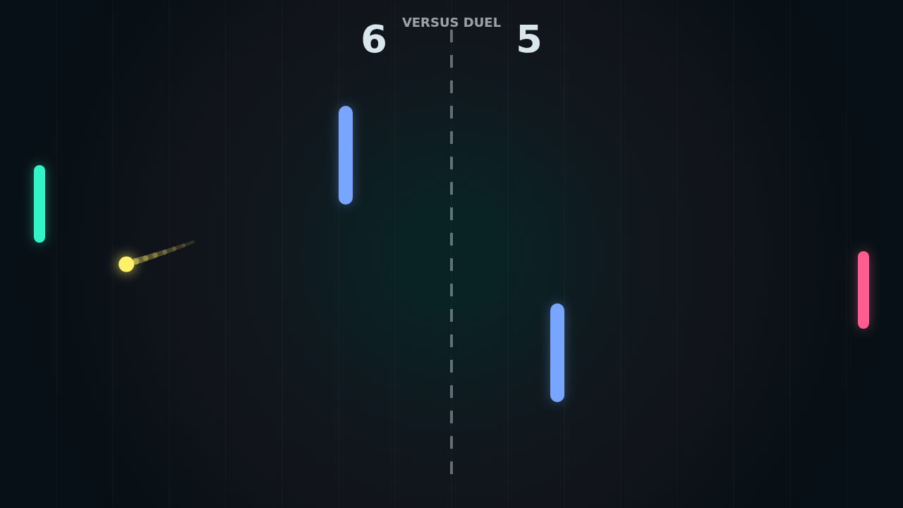

Carom is a quick, bright duel on a dark court: two paddles, one fast ball, and a
pair of center obstacles that turn every rally into a geometry problem. The
first serve comes straight from center court, then each return starts to carve a
different route through the field.

The paddle is not just a wall. Hit while moving and the ball picks up spin,
bending after contact and changing the next bounce. A clean defensive swipe can
turn into a looping bank shot that sneaks around the obstacle lane.

Solo mode lets you test those curves against a right-side AI that tracks the
incoming ball. Versus keeps the same compact pressure and hands both paddles to
the keyboard, so match point becomes a contest of timing, angles, and nerve.

